[](https://github.com/grimh3xx/credreap/actions)
[](LICENSE)


**A lockout-aware credential-attack orchestrator for authorized engagements, in Rust.**
It coordinates the credential phase of a pentest — paced password spraying and
hashcat-driven cracking — against the hosts *you* name, and keeps everything it
recovers in one store. It paces itself to **avoid locking accounts out**; it does
not scan the internet, discover targets, or evade detection.

<p align="center"></p>

> ⚠️ **Authorized use only.** Spraying requires `--i-am-authorized`. Use credreap
> solely against systems you are explicitly permitted to assess. You are
> responsible for staying within your rules of engagement.

## What it does

- **Lockout-aware spraying** — sprays one password across all accounts per round,
  caps attempts per account per window, and **waits out the lockout window**
  before the next round. Jitter and bounded concurrency included. The point is to
  test credentials *without* taking accounts offline.
- **Cracking orchestration** — drives **hashcat**: guesses the `-m` mode from the
  hash, builds the command, runs it, and collects the recovered plaintexts —
  locally or **distributed** across worker nodes by keyspace (over `ssh`).
- **Credential store** — spray hits and cracked hashes land in one JSON file,
  with a password-**reuse** view across users and sources.
- **Complements [netreap](https://github.com/grimh3xx/netreap)** — netreap owns
  SMB/LDAP/Kerberos; credreap is the pacing engine, HTTP protocol and cracking
  coordinator.

## Install

```bash
git clone https://github.com/grimh3xx/credreap
cd credreap
cargo build --release   # ./target/release/credreap
```

Cracking needs a working `hashcat` on the machine (or on the workers).

## Usage

### Spray

```bash
# HTTP Basic, one seasonal password, safely paced (1 try/account per 30 min)
credreap spray --i-am-authorized \
  --url https://portal.target/ --basic \
  -u users.txt --password 'Winter2025!' \
  --fail-match 'Unauthorized'

# Form login, detect success by the post-login redirect, with jitter
credreap spray --i-am-authorized \
  --url https://app.target/login \
  --user-field email --pass-field pass --field 'csrf=...' \
  -u users.txt -p passwords.txt \
  --success-status 302 --jitter 400 --concurrency 4
```

Pacing flags: `--attempts-per-window` (default 1), `--window` seconds (default
1800), `--round-delay`, `--jitter` ms, `--concurrency`, `--locked-status` to
detect lockouts and back off.

### Crack

```bash
# Local — mode guessed from the first hash (override with --mode)
credreap crack -H ntlm.txt -w rockyou.txt -r best64.rule

# Distributed across workers, split by keyspace over ssh
credreap crack -H hashes.txt -w wordlist.txt --mode 1000 \
  --worker op@node1 --worker op@node2
```

### Store

```bash
credreap creds list          # recovered credentials (secrets masked)
credreap creds reuse         # password reuse grouped by user
credreap creds add --user alice --secret 'Winter2025!' --source 'rdp 10.0.0.5'
```

Add `--json` for machine-readable output on any command.

## How the lockout guard works

Classic spraying lockout happens when one account sees too many attempts too
fast. credreap structures the attack to make that hard:

1. One password is tried across **all** accounts (a round) — so each account sees
   at most one attempt per round.
2. After `--attempts-per-window` rounds, it **sleeps the rest of the window**
   before continuing, keeping every account under the policy threshold.
3. `--locked-status` lets a protocol report a lockout so you can see it and stop.

The defaults (1 attempt / 30-minute window) are conservative on purpose.

## Scope & ethics

credreap is for **authorized** security testing. It deliberately:

- ✅ Tests credentials you supply against targets you name, paced to protect the
  target, and records what it finds.
- ❌ Does not discover or scan targets, stuff credentials across the internet,
  harvest breach data for mass targeting, or evade security controls.

## Roadmap

- [ ] More spray protocols (SSH, LDAP, RDP, SMTP/IMAP, OWA/EWS)
- [ ] John the Ripper backend alongside hashcat
- [ ] Resume/state file for long sprays
- [ ] SARIF / HTML engagement report

## License

MIT — see [LICENSE](LICENSE).
